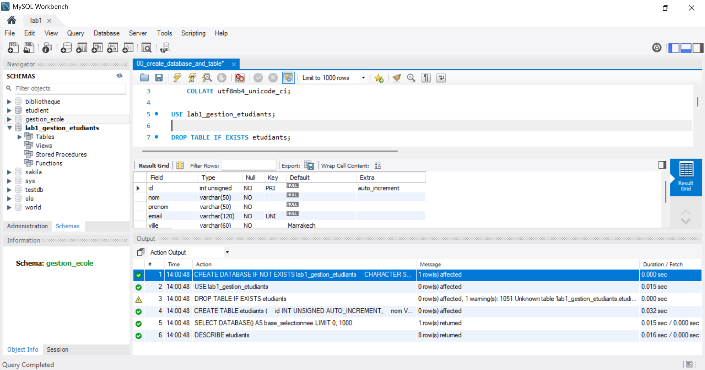
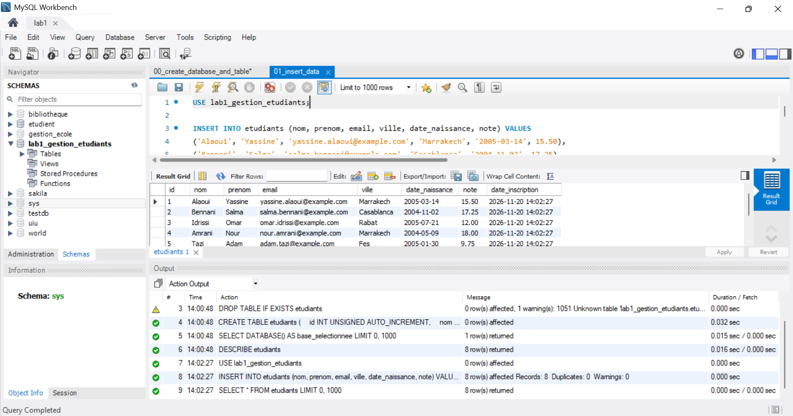
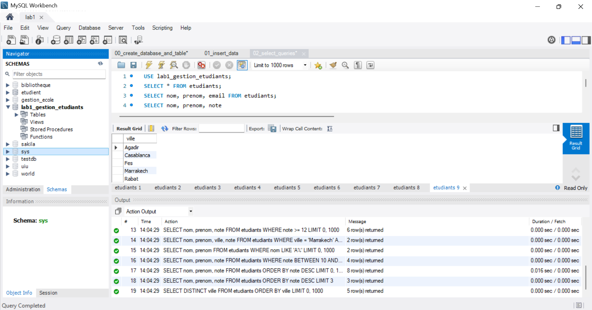
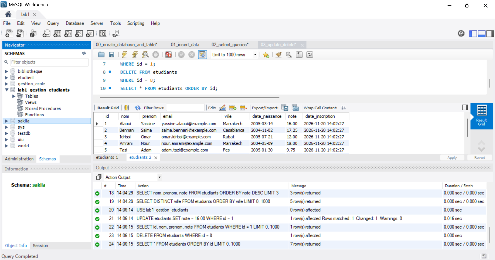
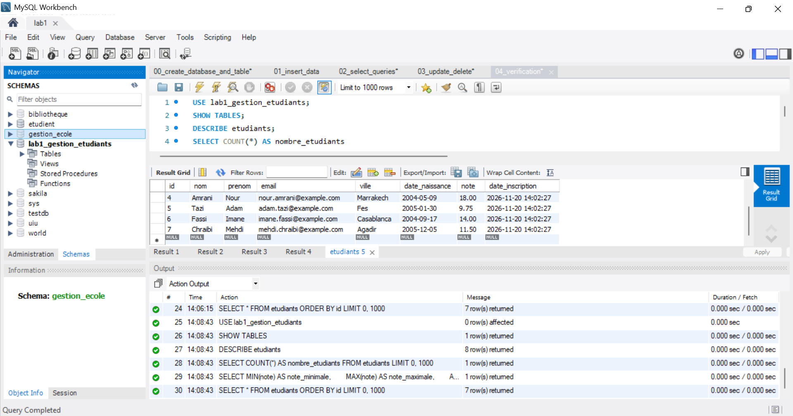

# MySQL Lab 1

Fichiers SQL

Les scripts SQL sont disponibles dans le dossier mysql-lab-1/sql. Ils sont organisés selon l'ordre d'exécution :

1 Création de la base de données et de la table

2 Insertion des données

3 Requêtes SELECT

4 UPDATE et DELETE

5 Vérification

Captures d'écran de l'exécution

## 1. Création de la base de données et de la table

## 2. Insertion des données

## 3. Requêtes SELECT

## 4. UPDATE et DELETE

## 5. Vérification

